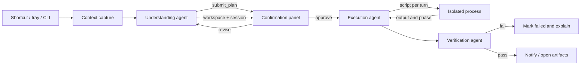
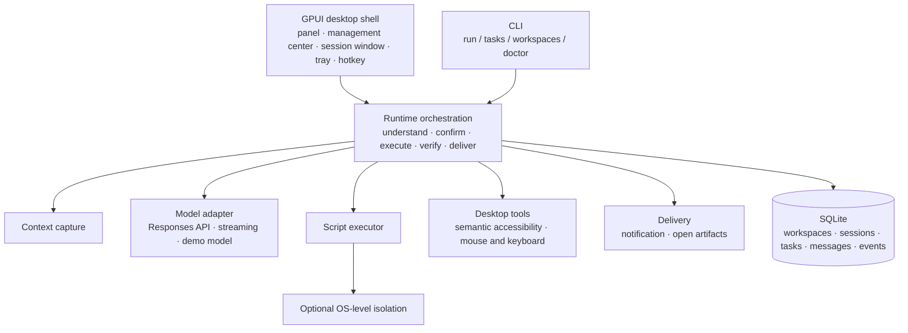

# Relay

**Hand off the work. Keep your flow.**

Relay is a context-aware, shell-native desktop agent that lives in your menu bar or system tray. One shortcut is enough: it reads the screen in front of you, turns a rough intention into a reviewable plan, then does the work in the background with scripts, command-line tools, and native UI automation. You keep working; the result lands next to you.

> Stop prompting. Start delegating. Bring AI to the work instead of hauling the work to AI.

`Rust` · `GPUI` · `OpenAI Responses API` · `Local-first` · `Shell-native`

One shortcut. One confirmation. Keep working.

> **Status: early development (0.1.0).** The full understand → confirm → execute → verify → deliver loop runs end to end, but APIs, configuration keys, and UI are still changing. This README describes the current implementation, not a stable contract.

---

## Why Relay

Most AI tools charge an upfront tax: open a chat, restate the context, hunt for the files, upload them, craft a prompt, then figure out where the output should go.

Relay reverses the flow. One shortcut and it looks first — frontmost app, window title, clipboard, authorized folders — then thinks: what is the task, where is the material, which workspace does this belong to. Then it hands you a plan. You approve once.

| | Typical chat agent | Relay |
|---|---|---|
| Entry point | Open an app, start a chat | Global shortcut from any app |
| Context | You describe it and upload files | Reads frontmost app, clipboard, authorized folders |
| Output | Text in a transcript | Files in a workspace, one-line conclusion in a notification |
| Execution | Cloud sandbox or opaque backend | Local, isolated processes with inspectable scripts and logs |
| Interruption | You watch the conversation | Runs in the background, never steals focus, stoppable at any time |

---

## How a task unfolds

1. **Trigger** — Press the global shortcut (`ctrl+alt+space` by default). Add an instruction, or leave it empty.
2. **Understand** — Relay captures the frontmost app, window title, and a clipboard excerpt, and prefetches a screenshot of the current window. It then inspects the screen and files with lightweight tools as needed.
3. **Route** — The same understanding agent decides the workspace and session: create, reuse, or switch.
4. **Confirm** — A floating panel shows the objective, steps, references, and delivery mode. Revise the request to re-run understanding, or approve.
5. **Execute** — The executor works in the background, one turn at a time: a short process note, then tool calls. Tasks in the same session are serialized; different sessions run in parallel.
6. **Verify** — A verifier performs a read-only check that artifacts exist and match the objective, then returns a verdict.
7. **Deliver** — A system notification carries the conclusion; the artifact file or folder opens on request.



---

## Design principles

| Principle | What it means |
|---|---|
| Context-aware | Read the frontmost app, window, clipboard, and authorized folders only when triggered; no continuous screen recording |
| Prompt-optional | An empty input is valid: infer the objective from what is on screen |
| Plan before action | Understanding inspects before any action; execution starts only after approval; the execution policy is injected by the runtime and cannot be relaxed by the model |
| Local-first | Tasks, sessions, messages, and artifacts live in local SQLite and local folders |
| Present, not intrusive | Menu-bar residence, floating panels, system notifications; no fight for focus |
| Few tools, real execution | A small tool surface, with the actual work done by Bash / PowerShell and Python |
| Native delivery | Not a chat reply, but an openable file, folder, and a clear conclusion |

---

## Architecture



### Tech stack

| Layer | Choice |
|---|---|
| Desktop and runtime | Rust (2021 edition; some tool crates use 2024) |
| Native UI | GPUI Kit |
| Async runtime | Tokio |
| Model interface | OpenAI Responses API (`/v1/responses`), streaming, tested against OpenAI-compatible endpoints including DeepSeek |
| Task execution | Bash / PowerShell + Python 3 and command-line tools |
| Local persistence | SQLite (`rusqlite`, bundled) |
| Desktop integration | `tray-icon` / `muda` / `global-hotkey` / `xcap` / `arboard` |
| Accessibility and input | `xa11y` (AX / UIA / AT-SPI), `enigo` (CGEvent / SendInput / XTest) |

### Three agents

| Phase | Responsibility | Available tools | Terminates with |
|---|---|---|---|
| Understanding | Read the instruction or screen, inspect materials and history, choose workspace and session | `get_environment`, `take_screenshot`, `read_clipboard`, `read_file`, `list_files`, `list_workspaces`, `list_sessions`, `list_tasks`, `read_image`, `search`, `fetch`, `computer_accessibility` (used for inspection) | `submit_plan` |
| Execution | Carry out the approved plan, produce artifacts, self-check | `bash`, `read_file`, `list_files`, `read_image`, `search`, `fetch`, `computer_accessibility`, `computer_input` | `submit_result` |
| Verification | Read-only check that artifacts exist and satisfy the objective | `list_files`, `read_file`, `read_image` | `submit_verification` |

There is no separate string-matching router. Which workspace to use and whether to continue an existing session are judgments the understanding agent makes after seeing real context; routing is a by-product of understanding. `relay-router` only tokenizes mixed Chinese/English text and ranks sessions, putting the most likely option first.

### Execution model: scripts are the unit of work

- Every turn produces an executable script: Bash on macOS and Linux, PowerShell on Windows. Scripts may invoke `python3`, command-line utilities, and authorized local programs.
- Each turn runs in its own process with a timeout and an output cap, and each task has a turn cap. The task directory persists, and every script is written to disk for inspection.
- Pressing Stop kills the whole process group immediately instead of waiting for the script to finish.
- The task phase is written back through the structured `submit_result` tool call; the legacy `relay-state` text protocol remains as a fallback, and code blocks in replies are never executed as commands.
- Isolation is optional. With `sandbox = true` on a supported platform, macOS `sandbox-exec` generates a default-deny profile that allows writes only under the task directory, temporary directories, and authorized directories. With the default `sandbox = false`, scripts are bounded by the execution policy (confirmation, timeout, turn cap, output cap); only the artifact opened on delivery is checked to be inside the workspace.

### Context engineering

Model calls use **stateless replay**: no server-side conversation state. The previous turn's `reasoning` and `function_call` items are sent back verbatim, with a `function_call_output` for every `call_id`. On top of that, three things keep long tasks affordable:

- **Stable prefixes** — execution input is ordered as session history → task and plan → executed transcript → current-turn progress. The most stable content comes first, which improves server-side token-cache hits.
- **Separate budgets** — session history and execution transcript each get their own token budget, sized as a fraction of the context window.
- **Compaction** — when estimated input exceeds 90% of the window, the model summarizes the history into a resumable brief. The summary is appended after the original text to preserve the cached prefix.
- **Replay across restarts** — every request is recorded before dispatch. Resuming a task, or continuing the same session in a new task, replays the recorded input byte for byte instead of re-rendering it, so reopening Relay keeps the cached prefix. If a crash lands between dispatch and the checkpoint write, the recorded request is still replayed and the calls it left open are answered with a fixed interruption receipt; a genuinely new prefix only starts when the model, tool set or prompt changed.

### Workspaces and sessions

A workspace is an independent business context; a session preserves continuity across related tasks. The first task creates the folder structure automatically. The `rules.md` file at the workspace root is re-read on every task, so editing it in place takes effect immediately.

```text
~/.relay/
├── config.toml
├── relay.sqlite3              # workspaces, sessions, tasks, messages, events, artifacts
├── workspaces/
│   └── <name>-<id8>/
│       ├── rules.md           # workspace rules, re-read on every task
│       ├── materials/         # source material
│       └── outputs/           # deliverables
├── tasks/<task-id>/
│   └── .relay/                # per-turn scripts, phase files, temporary screenshots
├── understanding/<uuid>/      # screenshots captured during understanding
├── bin/relay-state            # legacy state-protocol helper
├── relay.sock                 # single-instance socket, held by the running desktop shell
└── logs/relay.<date>.log      # daily rotation, seven days retained
```

Workspaces created by earlier localized builds are migrated on first use: legacy rules files and folders are renamed to the English layout. Tasks in the same session run serially; different sessions do not block each other. The task state machine only permits valid transitions, and pause, resume, and cancel are owned by the runtime.

---

## Getting started

### Requirements

- Rust stable (some crates use edition 2024)
- macOS (primary development platform), Windows, or Linux. Wayland limits accessibility and synthetic input.
- Bash and Python 3 (PowerShell and Python on Windows)
- An endpoint compatible with the **OpenAI Responses API** (`/v1/responses`) and an API key

### Build and run

```bash
cargo run -p relay-desktop
```

The first run creates `~/.relay/config.toml` with defaults. Without an API key, Relay falls back to an offline demo model that exercises the entire loop, so you can try it before wiring up a provider.

Release build:

```bash
cargo build --release -p relay-desktop
# binary: target/release/relay
```

### Configuration

```toml
# ~/.relay/config.toml
hotkey = "ctrl+alt+space"
model = "deepseek-flash"          # change to a model your endpoint serves
base_url = "https://api.openai.com/v1"
# api_key = "sk-..."              # prefer the environment variable to avoid plaintext on disk

include_clipboard = true          # include a clipboard excerpt in the context snapshot
include_screenshot = false        # attach a screenshot to the context snapshot
prefetch_screen = true            # capture the current window before understanding
require_confirmation = true       # require approval before execution
auto_open = false                 # open artifacts automatically on delivery
sandbox = false                   # macOS sandbox-exec isolation (disabled by default)
max_rounds = 24
timeout_secs = 300
context_window = 256000           # 0 disables accounting and compaction
allowed_dirs = []                 # additional authorized folders; workspaces are added automatically
```

The `search` and `fetch` tools call `{base_url}/tools/search` and `{base_url}/tools/fetch` with the same key, so they work on any endpoint that serves the DeepSeek tools API (for example `https://api.deepseek.com/v1`); elsewhere they report the upstream error instead of failing the task.

Environment variables take precedence over the config file:

| Variable | Purpose |
|---|---|
| `RELAY_OPENAI_API_KEY` / `OPENAI_API_KEY` | Model API key |
| `RELAY_OPENAI_MODEL` | Model name |
| `RELAY_OPENAI_BASE_URL` | API base URL |
| `RELAY_HOME` | Data directory, defaults to `~/.relay` |
| `RELAY_LOG` / `RUST_LOG` | Log level, for example `relay=debug` |

### System permissions

- **macOS**: Accessibility for semantic UI actions and synthetic input, Screen Recording for screenshots, Microphone for hold-to-talk dictation, and Notifications for delivery. A bundled `.app` must also declare `NSMicrophoneUsageDescription`; launched from a terminal, the grant applies to the terminal.
- **Windows**: a normal-privilege process cannot automate an app running as administrator.
- **Linux**: X11 works; Wayland restricts global hotkeys, screen capture, and synthetic input.

When a permission is denied, Relay stops and reports which grant is missing instead of retrying indefinitely.

### CLI

```bash
relay                              # start the desktop panel (tray and shortcut)
relay run "Turn the invoice screenshots into a single ledger.xlsx"
relay run "..." --mock             # exercise the offline demo model
relay tasks                        # 20 most recent tasks
relay workspaces                   # list workspaces
relay doctor                       # check data directory, key, Bash / Python, isolation support
```

`relay run` skips confirmation by default, which suits scripts and automation. The desktop panel keeps confirmation enabled.

---

## Repository layout

| Path | Responsibility |
|---|---|
| `crates/relay-core` | Domain models, task state machine, execution policy |
| `crates/relay-storage` | SQLite persistence for workspaces, sessions, tasks, messages, steps, artifacts, events |
| `crates/relay-context` | Context capture: frontmost window, clipboard, screenshots |
| `crates/relay-router` | Mixed-language tokenization and session ranking (does not route on its own) |
| `crates/relay-openai` | Responses API client, streaming, offline demo model |
| `crates/relay-runtime` | Agent pipeline, tool layer, budget compaction, session gates, event broadcast |
| `crates/relay-executor` | Script executor: isolated process, timeout, output cap, phase protocol |
| `crates/relay-sandbox` | macOS `sandbox-exec` profile generation |
| `crates/relay-platform` | Clipboard, window capture, global hotkey, tray, platform shell adapter |
| `crates/relay-tool-api` | Shared protocol and argument validation for computer tools |
| `crates/relay-input-tool` | `computer_input`: mouse and keyboard with human-like motion |
| `crates/relay-accessibility-tool` | `computer_accessibility`: semantic UI queries and actions |
| `crates/relay-delivery` | System notifications and opening artifacts |
| `crates/relay-desktop` | GPUI shell, tray, hotkey, CLI entry point |
| `prompts/` | Understanding, execution, verification, and compaction prompts |
| `runtime/bin/relay-state` | Legacy state-protocol helper, copied into each task directory |

---

## Privacy and safety

Relay is designed around explicit triggers and least privilege, and the boundaries deserve to be stated plainly:

- **Capture only on trigger.** No continuous screen recording, no keyboard monitoring. Understanding prefetches one screenshot of the current window (`prefetch_screen`); additional screenshots in the context snapshot are controlled separately by `include_screenshot`.
- **Local-first is not offline.** Selected context — window text, clipboard excerpts, screenshots, file contents — is sent to the `base_url` you configure for inference.
- **Execution has bounds.** Confirmation is required by default; per-turn timeout, task turn count, and output size are capped; the artifact opened on delivery is checked to be inside the workspace.
- **Isolation is opt-in.** OS-level isolation is available only on macOS with `sandbox = true`. With the default `sandbox = false`, scripts can read and write arbitrary paths and can access the network. `allowed_dirs` is primarily context guidance and partial path validation, not a hard filesystem sandbox.
- **Desktop automation depends on OS grants.** Missing Accessibility or Screen Recording permission fails the task with an explanation; Relay does not ask you to finish the work by hand.
- **Credentials stay local.** The API key may live in `~/.relay/config.toml` (plaintext) or in an environment variable. There is no telemetry and no cloud execution environment.

---

## Known limitations and roadmap

Available today:

- [x] Menu-bar residence, global shortcut, minimal panel, management center, session window
- [x] Trigger-based context capture, window screenshots, clipboard access
- [x] Hold-to-talk dictation in the panel input, transcribed by DeepSeek ASR (`{base_url}/tools/asr`)
- [x] Single instance: a second launch raises the running panel instead of starting another shell
- [x] Responses API client, streaming rendering, stateless replay
- [x] Automatic workspace and session selection by the understanding agent
- [x] Plan approval, background execution, pause / resume / cancel
- [x] Script executor, task directories, execution logs, optional sandbox
- [x] Verification agent, system notifications, native artifact opening
- [x] Context budgeting and compaction, per-session serialization
- [x] English UI, prompts, and workspace scaffolding

Still in progress:

- [ ] Installers, code signing, and auto-update
- [ ] OS-level isolation and full regression coverage on Windows and Linux
- [ ] A separate vision model configuration (the runtime field exists; the desktop settings do not expose it yet)
- [ ] Finer-grained tool approvals and execution audit trails
- [ ] More end-to-end tests for real office workflows

---

## Development

```bash
cargo fmt
cargo clippy --workspace --all-targets
cargo test --workspace
RUST_LOG=relay=debug cargo run -p relay-desktop
```

### Benign macOS console lines

Running the desktop from a terminal can print lines that macOS writes itself, not relay:

```text
TSM AdjustCapsLockLEDForKeyTransitionHandling - _ISSetPhysicalKeyboardCapsLockLED Inhibit
error messaging the mach port for IMKCFRunLoopWakeUpReliable
```

The first comes from Text Services Manager syncing the Caps Lock LED, the second from Input Method
Kit waking the input source; both fire when the panel takes key focus with more than one input
source installed. They are harmless, are never written to `~/.relay/logs/`, and cannot be
suppressed by the app. Filter them when reading the terminal:

```bash
cargo run -p relay-desktop 2>&1 | grep -v -e "TSM AdjustCapsLock" -e "IMKCFRunLoopWakeUpReliable"
```

Prompts live in `prompts/*.md` and are embedded with `include_str!`; rebuild after editing them. Runtime logs are written to `~/.relay/logs/` and also appear in the terminal when launched from a shell.

---

## Contributing

Feedback, architecture discussions, and reproducible workflow examples are welcome. If you are interested in context-aware desktop agents, Rust-native interfaces, or safe local code execution, open an issue and help shape Relay.

**The best AI interface is almost no interface at all.**

Relay — Hand off the work. Keep your flow.

---

## License

Apache-2.0
